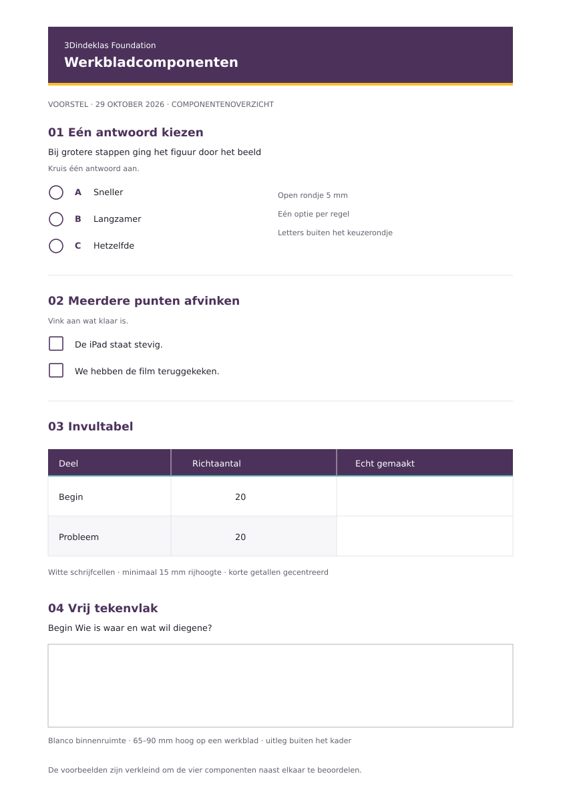

# Voorstel voor vaste werkbladcomponenten

Status: voorstel ter beoordeling. Datum: 29 oktober 2026.

Dit voorstel vult Foundation 1.2.0 aan met concrete bouwstenen voor leerlingwerkbladen. De bestaande kleuren, Quicksand, A4-opzet en kop- en voetteksten blijven de basis. De bouwstenen zijn toegepast op de zes werkbladen van Stopmotion met Greenscreenbox.



## Waarom deze aanvulling

De bestaande stijlguide noemt antwoordruimte en tabellen, maar maakt één antwoord kiezen, meerdere punten afvinken en zelf iets invullen nog onvoldoende van elkaar te onderscheiden. Ook zijn printlijnen en blanco tekenruimte nog niet als herbruikbare onderdelen uitgewerkt.

## Keuzevraag met één antwoord

- Begin met een genummerde vraag en de instructie **Kruis één antwoord aan**.
- Gebruik een open rondje van 5 mm met een paarse rand. Geef de opties daarnaast de letters A, B en C. Letters staan buiten het rondje, zodat het rondje helemaal beschikbaar blijft voor een kruis.
- Zet één optie per regel. Lijn afgebroken tekst uit met het begin van de antwoordtekst, niet met het keuzerondje.
- Gebruik 11 pt Quicksand Medium voor de tekst en Bold voor de optieletters. Gebruik 8–12 mm regelhoogte, met 10 mm als standaard.
- Houd de hele vraag en alle opties op dezelfde pagina. Geef ook een eventuele toelichting een eigen antwoordruimte.
- Kleur markeert geen goed of fout antwoord op het leerlingblad. Een blanco leerlingblad bevat geen vooraf geselecteerde opties.

**Voorbeeld:** Bij grotere stappen ging het figuur door het beeld: A Sneller, B Langzamer, C Hetzelfde.

## Checklist met meerdere vinkjes

- Gebruik een vierkant vakje van 5 mm met een paarse rand. Bij meerdere acties mogen meerdere vakjes aangevinkt worden.
- Schrijf **Vink aan wat klaar is** als de bedoeling niet vanzelf uit de kop blijkt.
- Gebruik dezelfde tekstgrootte, inspringing en regelhoogte als bij keuzevragen. De vorm en instructie geven het verschil aan, niet de kleur.
- Gebruik een checklist voor observeerbare handelingen, zoals **De iPad staat stevig** of **We hebben de film teruggekeken**.
- Maak een ja/nee-kennisvraag niet op als een afvinklijst: de leerling kiest daar één antwoord.

## Invultabel voor leerlingen

De bestaande Foundation-tabel is de basis: paars met witte tekst in de koprij, een dunne teal onderrand, lichte scheidingen en afwisselend witte en lichtgrijze informatieregels.

De aanvullende invulvariant:

| Eigenschap | Voorstel |
| --- | --- |
| Tekst | 10 pt Quicksand Medium; korte kolomkoppen in Bold |
| Celruimte | Circa 2,3 mm binnenmarge |
| Rijhoogte | Minimaal 15 mm als de leerling schrijft; 18–22 mm bij namen of langere antwoorden |
| Invulcellen | Altijd wit, ook naast een lichtgrijze informatierij |
| Korte getallen en vinkjes | Horizontaal gecentreerd |
| Beschrijvingen en namen | Links uitgelijnd; tekst verticaal gecentreerd |
| Kolombreedte | Bepalen op basis van de inhoud; naam- en antwoordkolommen krijgen schrijfruimte |
| Paginaovergang | Een rij niet splitsen; een koprij herhalen als een lange tabel doorloopt |

Een antwoordvak wordt niet kleiner gemaakt om een volle pagina te laten passen. Maak eerst de vraag korter of verplaats een volledig blok naar een vervolgpagina.

## Vrij tekenvlak en storyboard

- Gebruik een volledig wit, onbedrukt vlak met een rand van 0,5 pt.
- Zet de titel en tekenopdracht boven het vlak. Zet **Wat beweegt** of een andere toelichtingsvraag eronder. Schrijf instructies niet midden in de tekenruimte.
- Houd voor een vrij tekenvlak 65–90 mm hoogte aan. De stopmotionvariant gebruikt 85 mm voor het begin en 65 mm voor probleem en einde.
- Een raster is alleen een aparte variant als meten of uitlijnen onderdeel van de opdracht is. Een storyboard blijft blanco.
- Label ieder verhaalvak met **Begin**, **Probleem** of **Einde**. De drie vakken zijn momenten in één verhaal.
- Houd titel, kader en bijbehorende korte antwoordregel op dezelfde pagina. Verdeel een storyboard over meerdere pagina's als anders te weinig tekenruimte overblijft.

## Schrijfregels en identificatievelden

- Gebruik twee of drie schrijfregels voor een kort antwoord en vier tot zes voor een uitleg.
- Gebruik circa 9 mm tussen de regels; pas dit aan bij groter handschrift.
- Zet de vraag direct boven de regels. Houd alle regels die bij één vraag horen bijeen.
- Gebruik een label boven een kort identificatieveld, zoals **Teamnummer** of **iPadnummer**. Herhaal alleen gegevens die nodig zijn om losse bladen terug te vinden.

## Voorgestelde printtokens

De bestaande kleur `line` blijft de standaard voor lichte tabelscheidingen en schermranden. Als aanvulling stellen we `responseLine` voor: een donkerder printlijn voor schrijven en tekenen. Deze kleur is functioneel, geen nieuwe merkkleur.

Voorgestelde plek na akkoord: `documents.pdf.worksheet.components` in `brand.json`.

```json
{
  "singleChoice": {
    "marker": "circle",
    "markerSizeMm": 5,
    "optionLabels": ["A", "B", "C"],
    "instruction": "Kruis één antwoord aan.",
    "rowHeightMm": 10,
    "rowHeightRangeMm": [8, 12],
    "textSizePt": 11
  },
  "checklist": {
    "marker": "square",
    "markerSizeMm": 5,
    "instruction": "Vink aan wat klaar is.",
    "rowHeightMm": 10
  },
  "inputTable": {
    "cellPaddingMm": 2.3,
    "minimumWritingRowHeightMm": 15,
    "inputCellFill": "#FFFFFF",
    "repeatHeader": true,
    "splitRows": false
  },
  "drawingArea": {
    "minimumHeightMm": 65,
    "preferredHeightRangeMm": [65, 90],
    "fill": "#FFFFFF",
    "borderWidthPt": 0.5,
    "instructionsOutside": true
  },
  "writingLines": {
    "linePitchMm": 9,
    "strokeWidthPt": 0.5,
    "responseLine": "#9B949F"
  }
}
```

## Toepassing en controle

De Word-werkbladen gebruiken echte tekst, invultabellen en blanco tekenvakken. De kleine keuze- en afvinktekens zijn scherpe afbeeldingen om ontbrekende lettertekens bij print te voorkomen. Ze ondersteunen steeds een leesbaar tekstlabel.

Controleer een export op A4 op ware grootte: zijn tekst, randen en schrijfregels zichtbaar, ook in grijstinten? Controleer daarnaast dat een vraag niet los van zijn antwoordvak staat en dat er geen afgesneden logo's, losse tabelrijen of lege vervolgpagina's ontstaan. Een digitale grijstintencontrole vervangt geen fysieke proef op de schoolprinter.

## Wat dit voorstel wel en nog niet vastlegt

Deze pullrequest voegt alleen de beschreven bouwstenen en hun visuele referentie toe. De bestaande `brand.json`, CSS en gepubliceerde voorbeelden worden hiermee nog niet aangepast. Na akkoord kunnen de voorgestelde tokens worden opgenomen, de regels aan de hoofd-stijlguide worden toegevoegd en webvoorbeelden worden gebouwd. Een toevoeging aan de vastgestelde componenten hoort bij een minor-versie, bijvoorbeeld 1.3.0.
